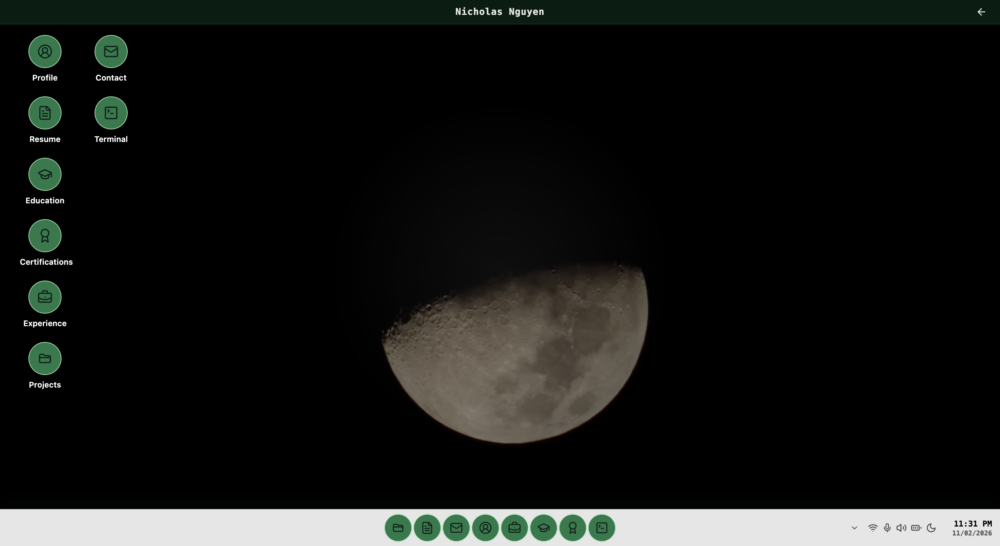

  <h1>Nicholas Nguyen</h1>

  

    Final-year SWE student. I build web applications and systems. I’m currently researching latency diagnosis in cloud gaming.
  

  

    <a href="https://nghi-creator.github.io/"><strong>Portfolio</strong></a>
    ·
    <a href="https://www.linkedin.com/in/nicholas-nguyen-3bb17a335/">LinkedIn</a>
    ·
    <a href="https://www.credly.com/users/nghi-nguy-n-gia/badges/credly">Certifications</a>
    ·
    <a href="https://dev.to/nicholasthegreat">Writing</a>
    ·
    <a href="mailto:gianghi30032005@gmail.com">Email</a>
  

## CreatorOS

My portfolio, built like a small desktop. Open to explore my work, experience, or CVs.

  

  <a href="https://nghi-creator.github.io/"><strong>Open CreatorOS →</strong></a>

## Research

### Latency Fingerprinting for Edge Cloud Gaming

"Can a system’s response to a controlled change help explain what’s slowing it down?"

That’s the question behind my undergraduate thesis.

I’m building a Python research engine to analyze measurements from PIXELATED Studio. It supports experiment checks, fingerprint and profile matching, and offline evaluation. Controlled comparisons are being planned to test how well it distinguishes bottlenecks.

[Source](https://github.com/Nghi-creator/latency_fingerprinting) · [Research overview](https://github.com/Nghi-creator/latency_fingerprinting/blob/main/docs/README.md)

## Projects

### PIXELATED Studio

A self-hosted cloud-gaming platform that streams games from your computer to a browser. I built the desktop app, containerized runtime, and WebRTC streaming path. It also serves as my thesis testbed, with tools for collecting telemetry and running controlled experiments.

[Live app](https://pixelated-studio-edition.vercel.app/) · [Source](https://github.com/Nghi-creator/Pixelated-Studio-Edition) · [Latest release](https://github.com/Nghi-creator/Pixelated-Studio-Edition/releases/latest)

### PIXELATED User Edition

A browser gaming app that runs NES, Game Boy, and Game Boy Color titles locally through WebAssembly. It shares Studio’s accounts and catalog, while keeping personal game files on your device. No desktop app or streaming setup required.

[Live app](https://pixelated-user-edition.vercel.app/) · [Source](https://github.com/Nghi-creator/Pixelated-User-Edition)

## Technical skills

**Software:** TypeScript, JavaScript, Python, Java, C/C++, SQL, React, Node.js, Express.js, Fastify, Spring Boot

**Infrastructure and DevOps:** Linux, Docker, Kubernetes, Terraform, GitHub Actions, AWS, GCP

**Systems and media:** WebRTC, GStreamer, WebAssembly

**Research:** telemetry, benchmarking, latency analysis

## GitHub activity

  
  
  
  
  

